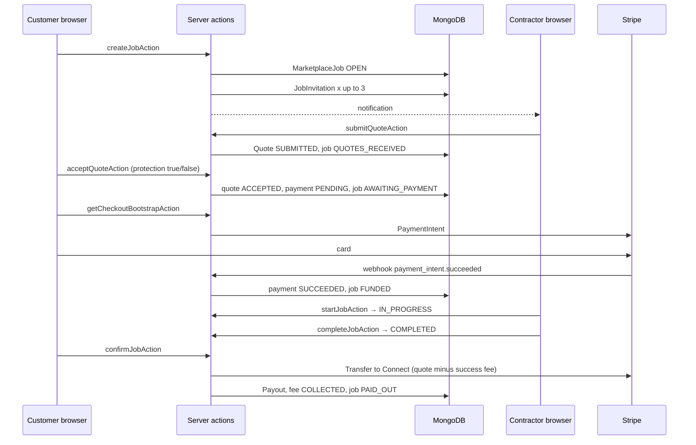

# BuildPro — Full site flow (frontend and backend)

How the website works end to end: who uses which screens, what the server does, and how data moves.

BuildPro is one Next.js app with **four surfaces**:

| Surface | Who | URL prefix | Purpose |
|---------|-----|------------|---------|
| Public site | Anyone | `/`, `/services` | Marketing, search trades, sign up |
| Customer portal | Homeowner (`CLIENT`) | `/customer/*` | Post jobs, pay, message traders |
| Contractor portal | Trader (`CONTRACTOR`) | `/construction/*` | Services, quotes, payouts |
| Staff dashboard | Admin and site staff | `/dashboard`, `/projects`, … | Projects, finance, users, pricing, disputes |

There are **two customer–trader ways of working**. They share users and notifications, and they do not share payment.

1. **Marketplace jobs** — post a job, match traders, quote, Stripe escrow, start / complete / confirm, dispute or payout.
2. **Service requests** — browse a trader’s listed service, send a request, chat. Status only. No escrow.

Staff also run an internal **construction management** system (projects, tasks, materials, invoices). That is separate from marketplace jobs.

---

## 1. How a click becomes data

```
Browser
  │
  ├─ Page (React server component) ── reads Prisma directly
  ├─ Form / button ── server action in src/actions/*
  └─ fetch / Stripe ── route handler in src/app/api/*
           │
           ▼
     auth() / requireAuth()     session JWT, role check
           │
           ▼
     Prisma  →  MongoDB
           │
           ├─ Notification row
           ├─ Email (SMTP template)
           ├─ Stripe (PaymentIntent, Connect, refund, transfer)
           └─ AuditLog
           │
           ▼
     revalidatePath()  →  next page render shows new data
```

**Stack**

| Layer | What it is |
|-------|------------|
| UI | Next.js App Router, React, Tailwind |
| Auth | NextAuth credentials, JWT session, refresh tokens in MongoDB |
| Data | Prisma + MongoDB (`prisma/schema.prisma`) |
| Money | Stripe Checkout-style PaymentIntent, Connect, webhooks |
| Mail | Admin SMTP settings + email templates |

**Route groups** (folders in parentheses do not appear in the URL):

| Folder | URLs |
|--------|------|
| `src/app/page.tsx`, `src/app/services` | Public |
| `src/app/(auth)` | `/login`, `/register`, password reset |
| `src/app/(customer-portal)` | `/customer/login`, `/customer/register` |
| `src/app/(customer-area)` | Logged-in customer |
| `src/app/(construction-portal)` | `/construction/login`, `/construction/register` |
| `src/app/(contractor-area)` | Logged-in contractor |
| `src/app/(dashboard)` | Staff |

**Guard rails**

- `middleware.ts` + `auth.config.ts` run on every page. Logged-out users go to `/login`. A `CLIENT` cannot open staff or contractor pages. A `CONTRACTOR` cannot open customer or staff pages. Staff cannot open customer or contractor areas. `/admin` needs role `ADMIN` or higher.
- Server actions call `requireAuth(roles)` again. The page guard is not the only check.
- After login, home is chosen in `src/lib/role-home.ts`: customer → `/customer/dashboard`, contractor → `/construction/dashboard`, everyone else → `/dashboard`.

---

## 2. Roles

| Role | Portal | Created by |
|------|--------|------------|
| `CLIENT` | Customer | `/customer/register` or `/register` |
| `CONTRACTOR` | Contractor | `/construction/register` |
| `SUPER_ADMIN`, `ADMIN` | Staff | Seed or Users screen |
| `PROJECT_MANAGER`, `SITE_ENGINEER`, `FOREMAN`, `ACCOUNTANT`, `VIEWER` | Staff | Users screen, optional custom `StaffRole` |

A **trader is verified** only when all three are true on the `User` row: Stripe Connect onboarding done, payouts enabled, and a fee card saved (`feePaymentMethodId`). Matching prefers verified traders. Quoting requires verification.

---

## 3. Public site

```
/                         Landing (hero search, how it works, trades)
  ├─ Find a Trader  →  /services          public service catalog
  ├─ Post a Job     →  /customer/register  (then login → post job)
  ├─ Log In         →  /login
  └─ Sign Up        →  /customer/register
```

`/services` lists active contractor `Service` records. Requesting one requires a customer login; the form posts `requestServiceAction`.

`/construction/login` and `/customer/login` redirect into the shared `/login`. Register pages stay separate so the correct role is created.

---

## 4. Auth flow

```
Register                         Login                         Session
────────                         ─────                         ───────
Customer form                    email + password              JWT in cookie
  registerAction                   loginAction                   access token ~short
  bcrypt hash                      NextAuth Credentials          refresh token in DB
  User.role = CLIENT               compare hash                  jwt callback refreshes
  welcome email                    reject if !isActive           sign-out revokes refresh tokens
  notify admins                    redirect ROLE_HOME

Contractor form
  contractorRegisterAction
  User.role = CONTRACTOR
  name stored as "Name — Company"
```

| Step | Page | Backend |
|------|------|---------|
| Customer sign up | `/customer/register` | `src/actions/auth/register.ts` |
| Contractor sign up | `/construction/register` | `src/actions/auth/contractor-register.ts` |
| Sign in | `/login` | `src/actions/auth/login.ts` → `auth.ts` |
| Forgot password | `/forgot-password` | `forgotPasswordAction` writes `PasswordResetToken`, emails link |
| Reset password | `/reset-password` | `resetPasswordAction` |
| Verify email | `/verify-email` | `verifyEmailAction` |
| Sign out | header | `logoutAction` → revoke refresh tokens |

Passwords are bcrypt hashes. Sessions are JWT, not database sessions. A dead refresh token sends the user to `/login?error=SessionExpired`.

---

## 5. Marketplace jobs (main money path)

This is the flow from **Post a job** through **payout**.

### Screens

| Step | Customer UI | Contractor UI | Staff UI |
|------|-------------|---------------|----------|
| Setup | — | Add service `/construction/services/new`. Verify `/construction/payouts` | Pricing `/settings/pricing` |
| Post | `/customer/jobs/new` | — | — |
| Match | Job detail shows invites | `/construction/invitations` | — |
| Quote | Quotes on job detail | Invitation detail, submit quote | — |
| Accept + pay | Accept panel, then `/customer/jobs/[id]/pay` | — | — |
| Work | Status on job detail | `/construction/jobs/[id]` Start / Complete | — |
| Close | Confirm, or Raise dispute / Report problem | Earnings, payouts | `/disputes` |

### Sequence



### Backend, step by step

**1. Customer posts a job** — `createJobAction` (`src/actions/marketplace/jobs.ts`)

- Role must be `CLIENT`.
- Validates title, description, category, optional location, budget, up to 8 photo URLs.
- Inserts `MarketplaceJob` with status `OPEN`.
- Writes an `AuditLog`.
- Calls `inviteTradersToJob` (`src/lib/matching.ts`).

**2. Matching**

- Loads active contractors who have at least one active service.
- Score: verified +100, exact category +40, soft category +15, request volume, location text match, minus recent invites (fairness).
- Fills up to `matchingInviteCount` (default **3**) live invites (`SENT` or `VIEWED`).
- Each invite expires after `invitationExpiryHours` (default **48**).
- Notifies each trader with a link to `/construction/invitations/[id]`.
- If a trader declines, or an invite expires, `maintainLiveInvitations` tops the list back up until `maxReassignments` (default **6**).

**3. Contractor quotes** — `submitQuoteAction` (`src/actions/marketplace/quotes.ts`)

- Must be the invited trader and `assertTraderVerified`.
- Invite must be `SENT` or `VIEWED` and not past `expiresAt`.
- Creates `Quote` (`SUBMITTED`, valid for `quoteValidDays`, default **14**).
- Marks the invitation `QUOTED`.
- If the job was `OPEN`, sets it to `QUOTES_RECEIVED`.
- Notifies the customer.

**4. Customer accepts** — `acceptQuoteAction`

One transaction:

- Quote must be `SUBMITTED` and the job `OPEN` or `QUOTES_RECEIVED`.
- Only one quote can be `ACCEPTED`. Others become `NOT_SELECTED`.
- Amounts come from `PricingConfig`, not from the browser.
- Creates `FeeLedger` (`PENDING`) for the trader success fee.
- Creates `MarketplacePayment` (`PENDING`) with customer total and protection flag.
- Job → `AWAITING_PAYMENT`, `protectionStatus` = `PROTECTED` or `UNPROTECTED`.
- Remaining live invitations → `EXPIRED`.

**Price (defaults, admin can change them)**

| Line | Default | Who pays |
|------|---------|----------|
| Quote | trader’s amount | customer |
| Protection fee | 3% of quote, only if Protected | customer, added on top |
| Trader success fee | 10% of quote (optional cap) | taken from trader payout |

Example: quote ₹10,000 Protected → customer pays about ₹10,300. Trader net is about ₹9,000 after the success fee.

**5. Pay** — `getCheckoutBootstrapAction` (`src/actions/marketplace/payments.ts`)

- Customer opens `/customer/jobs/[id]/pay`.
- Server creates or reuses a Stripe PaymentIntent for the pending `MarketplacePayment`.
- Card is confirmed in the browser with the publishable key.
- Job stays `AWAITING_PAYMENT` until the webhook runs.

**6. Webhook** — `POST /api/stripe/webhook` (alias `POST /api/payments/webhook`)

| Stripe event | Effect |
|--------------|--------|
| `payment_intent.succeeded` | Payment `SUCCEEDED`, job `FUNDED`, parties notified |
| `payment_intent.payment_failed` | Payment `FAILED` |
| `charge.refunded` | Payment refunded / partially refunded |
| `account.updated` | Connect onboarding and payouts flags on the trader |
| `setup_intent.succeeded` | Saves the trader fee card |

Events are deduped with an `AuditLog` row (`entity = stripe_event`).

**7. Work** — `src/actions/marketplace/lifecycle.ts`

| Action | Who | From status | To status |
|--------|-----|-------------|-----------|
| `startJobAction` | Accepted trader | `FUNDED` | `IN_PROGRESS` |
| `completeJobAction` | Accepted trader | `FUNDED` or `IN_PROGRESS` | `COMPLETED` |
| `confirmJobAction` | Customer | `FUNDED`, `IN_PROGRESS`, or `COMPLETED` | payout, then `PAID_OUT` |
| `cancelJobAction` | Customer | `OPEN` or `QUOTES_RECEIVED` | `CANCELLED` |
| `cancelFundedJobAction` | Customer | funded, before payout | refund path, `CANCELLED` |
| `runAutoConfirmAction` | System | `COMPLETED` past `autoConfirmDays` (default 5) | same as confirm |

**Payout rules** (`src/lib/marketplace-payouts.ts`)

- **Protected:** money stays in escrow until the customer confirms, or auto-confirm. Then Stripe Transfer of `quote − success fee` to the trader Connect account. Fee ledger → `COLLECTED`. Job → `PAID_OUT`.
- **Unprotected:** if admin setting `unprotectedReleaseAt` is `JOB_START` (the default), payout runs when the trader marks started. Customer can only **report a problem** (no refund guarantee).
- **Disputed:** `releaseJobPayout` refuses. Payout stays blocked until an admin resolves it.

**8. Decline** — contractor `declineInvitationAction`, or `POST /api/jobs/[id]/invitations/[iid]/decline`. Frees a slot and invites the next match.

### Job status

```
OPEN
  → QUOTES_RECEIVED          (first quote)
  → AWAITING_PAYMENT         (quote accepted)
  → FUNDED                   (webhook)
  → IN_PROGRESS              (trader start)
  → COMPLETED                (trader complete)
  → PAID_OUT                 (confirm / auto-confirm / unprotected release)

Side exits
  CANCELLED   before accept, or funded cancel
  EXPIRED     where a timeout job is marked
  DISPUTED    protected dispute open (payout blocked)
  RESOLVED    dispute closed; full release then also sets PAID_OUT
```

### Same actions over HTTP

The UI uses server actions. These routes call the same logic (useful for tests):

| Method | Path | Action |
|--------|------|--------|
| POST | `/api/jobs` | create job |
| POST | `/api/jobs/[id]/quotes` | submit quote |
| GET | `/api/quotes/[id]/price-preview` | price breakdown |
| POST | `/api/quotes/[id]/accept` | accept quote |
| POST | `/api/jobs/[id]/start` | start |
| POST | `/api/jobs/[id]/complete` | complete |
| POST | `/api/jobs/[id]/confirm` | confirm |
| POST | `/api/jobs/[id]/dispute` | raise dispute |
| POST | `/api/jobs/[id]/report-problem` | unprotected problem report |
| POST | `/api/disputes/[id]/resolve` | admin resolve |

---

## 6. Disputes and problem reports

**Protected only — Raise dispute** (`raiseDisputeAction`)

- Job must be `PROTECTED` and `FUNDED`, `IN_PROGRESS`, or `COMPLETED`.
- Reason at least 10 characters. One open dispute per job.
- Job → `DISPUTED`. Trader and admins notified. Payout blocked.

**Admin resolve** (`resolveDisputeAction`, page `/disputes/[id]`)

| Choice | Money | Job after |
|--------|--------|-----------|
| Full release | Transfer full net to trader | `PAID_OUT` |
| Partial release | Transfer a trader amount, refund the rest | `RESOLVED` |
| Full refund | Stripe refund of the PaymentIntent, fee voided | `RESOLVED` |

**Unprotected — Report a problem** (`reportProblemAction`)

- Writes a log and notifies trader and admins.
- No refund. Shows on `/disputes?tab=reports`.

---

## 7. Service requests and chat (no escrow)

```
Public /services  or  /customer/services
        │
        ▼
requestServiceAction
        │  ServiceRequest status PENDING
        │  email + notification to that contractor
        ▼
Contractor /construction/requests
        │
        ▼
updateRequestStatusAction
   PENDING → ACCEPTED → IN_PROGRESS → COMPLETED
                  └→ REJECTED
        │
        ▼
Messages on that request
   /customer/messages/[id]
   /construction/messages/[id]
   sendMessageAction  (text + optional attachment)
```

- One open request per customer per service (`PENDING`, `ACCEPTED`, or `IN_PROGRESS`).
- Chat is tied to `ServiceRequest`, not to `MarketplaceJob`.
- Status emails use templates such as `service_request_accepted`.
- `POST /api/service-request` is the HTTP form of the same create.

Use this path when the customer picked a specific trader’s listing. Use marketplace jobs when the customer wants matching and escrow.

---

## 8. Contractor setup (before they can be paid)

```
/construction/register
        │
        ▼
/construction/services/new     createServiceAction
        │  Service { title, category, price range, isActive }
        ▼
/construction/payouts
        │
        ├─ startConnectOnboardingAction
        │     Stripe Connect account link
        │     return via /api/stripe/connect/refresh
        │     webhook account.updated → stripeOnboardingDone, stripePayoutsEnabled
        │
        └─ createFeeSetupIntentAction + saveFeePaymentMethodAction
              card on file for the success fee
              webhook setup_intent.succeeded → feePaymentMethodId
```

Other contractor pages read the same user: dashboard, invitations, jobs, requests, messages, reviews, earnings, invoices, analytics, team, profile (`updateContractorProfileAction`).

---

## 9. Customer portal (besides the job)

| Page | What it does |
|------|----------------|
| `/customer/dashboard` | Summary of jobs and requests |
| `/customer/jobs` | List of marketplace jobs |
| `/customer/jobs/new` | Post a job |
| `/customer/jobs/[id]` | Quotes, status, confirm, dispute |
| `/customer/jobs/[id]/pay` | Stripe payment |
| `/customer/services` | Browse services (logged in) |
| `/customer/requests` | Service requests |
| `/customer/messages` | Chat threads |
| `/customer/notifications` | In-app notifications |
| `/customer/profile` | `updateClientProfileAction`, password |

---

## 10. Staff dashboard (construction management)

Staff sign in at `/login` and land on `/dashboard`. Pages are server components that query Prisma. Forms call server actions.

This data is the **internal project system**. A marketplace `MarketplaceJob` is not a `Project`. Clients here are the `Client` company records, not only login users.

```
Dashboard  /dashboard
   counts: projects, clients, users, open issues, invoices, tasks

Marketplace ops
   /projects              internal projects (also labeled Projects / Jobs in the nav)
   /admin/services        service catalog oversight
   /disputes              escrow disputes + problem reports
   /clients               client companies
   /contractors           contractor companies (directory, not the login user)

Resources
   /materials             inventory
   /equipment             plant

Operations
   /site-reports          daily site reports (+ /site-reports/new)
   /issues                site issues
   /documents             files on a project

Finance
   /invoices              project invoices and payments (cash, bank, UPI, …)
   /expenses              project expenses

Admin
   /admin                 admin home
   /users                 create staff, activate, reset password
   /roles                 StaffRole + permission list

Settings
   /settings              general
   /settings/pricing      marketplace rates (the money rules)
   /settings/profile      staff profile
   /settings/email        SMTP
   /settings/email-templates
```

### Project lifecycle (staff)

```
Create client          createClientAction          Client
        │
        ▼
Create project         createProjectAction         Project
   status PLANNING → IN_PROGRESS → ON_HOLD / COMPLETED / CANCELLED
   code, budget, dates, location, manager
        │
        ├─ milestones and tasks     createTaskAction, updateTaskStatusAction
        │     TODO → IN_PROGRESS → REVIEW → COMPLETED, or BLOCKED
        ├─ assign contractors       ProjectContractor (contract value, dates)
        ├─ materials                stock and ProjectMaterial usage
        ├─ equipment                AVAILABLE → IN_USE → MAINTENANCE → RETIRED
        ├─ documents                upload metadata + file URL
        ├─ site reports             createSiteReportAction (weather, labour, photos)
        ├─ issues                   OPEN → IN_PROGRESS → RESOLVED → CLOSED
        ├─ invoices                 createInvoiceAction
        │     DRAFT → SENT → PARTIAL → PAID, or OVERDUE / CANCELLED
        │     record Payment (bank, UPI, cash, cheque, card)
        └─ expenses                 createExpenseAction
```

Invoice money here is **recorded in the app**. It does not go through Stripe escrow. Stripe is only the marketplace job path.

### Users and roles

- `createUserAction` / `updateUserAction` / `deleteUserAction` / `toggleUserActiveAction` / `resetUserPasswordAction`.
- `StaffRole` maps a display name (for example Manager) onto a base `UserRole` plus a permission string list.
- `GET /api/users/[id]` returns one user. `GET /api/admin/export` exports CSV.

### Pricing (changes future quotes only)

`savePricingConfigAction` writes the singleton `PricingConfig` (`key = default`):

- Trader fee type, rate, cap, and per-category overrides
- Protection fee on/off, rate, default opt-in or opt-out
- When unprotected jobs release (`JOB_START` or `COMPLETION`)
- Quote validity days, invitation expiry hours, auto-confirm days
- How many live invites, max reassignments, terms version

Accept and price preview read this row. Amounts already stored on a payment are not rewritten.

---

## 11. Notifications and email

**In-app** — `createNotification` / `notifyAdmins` insert `Notification`. The bell and `/notifications` (staff), `/customer/notifications`, and `/construction/notifications` list them. Mark read or delete via `src/actions/notifications`.

**Email** — `src/lib/email.ts` loads active `SmtpSettings` and an `EmailTemplate` by key (welcome, reset, service request status, and similar). Admins edit SMTP at `/settings/email` and bodies at `/settings/email-templates`. If SMTP is missing, the send is skipped and the in-app notification still exists.

---

## 12. Data the screens read and write

```
User ─┬─ posted MarketplaceJobs (client)
      ├─ JobInvitations + Quotes (trader)
      ├─ Services + ServiceRequests (trader / client)
      ├─ Messages
      ├─ Notifications
      └─ Stripe Connect + fee card fields

MarketplaceJob
   ├─ JobInvitation
   ├─ Quote ── FeeLedger
   ├─ MarketplacePayment
   ├─ Payout
   └─ Dispute

Project (staff)
   ├─ Milestone → Task → Comment
   ├─ Client, manager User, ClientProject members
   ├─ ProjectContractor → Contractor
   ├─ Material / Equipment links
   ├─ Document, SiteReport, Issue
   └─ Invoice → InvoiceItem + Payment
      Expense
```

`AuditLog` records marketplace creates, accepts, payouts, Stripe events, and dispute decisions.

---

## 13. One-page map

```
PUBLIC
  /  /services  /login  /register  /customer/register  /construction/register

CUSTOMER                         CONTRACTOR                      STAFF
  dashboard                        dashboard                       dashboard
  post job ─────────────────────► invitations                      pricing
  job detail ◄── quotes ────────── invitation detail               disputes
  pay ── Stripe webhook ── FUNDED  start / complete                projects
  confirm / dispute ─────────────► payouts + earnings              clients, contractors
  browse services ──────────────► requests + messages              materials, equipment
  profile                          services, profile, team         site reports, issues
                                                                   invoices, expenses
                                                                   users, roles, email
```

QA steps for the marketplace path, test cards, and the bug template are in [TESTER_GUIDE.md](./TESTER_GUIDE.md).
